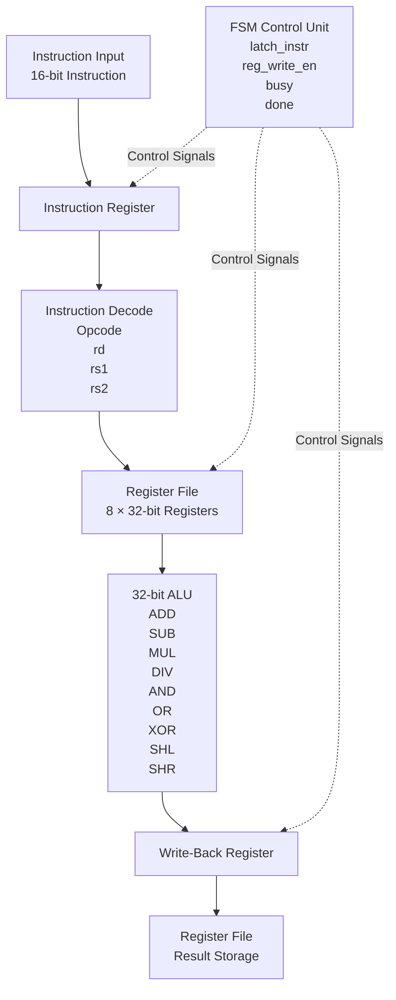

#  32-Bit Calculator Processor on FPGA

This project implements a simple 32-bit instruction-driven calculator processor using Verilog HDL. The design integrates a Register File, Arithmetic Logic Unit (ALU), Instruction Register, Write-Back Register, and an FSM-based Control Unit.
The processor accepts 16-bit instructions, decodes instruction fields, performs arithmetic and logical operations, and writes the result back to a destination register. The design was verified using Vivado simulation and implemented on FPGA hardware.

---

##  Project Objectives

- Design a 32-bit processor-like calculator architecture.
- Implement arithmetic and logical operations in hardware.
- Understand instruction encoding and decoding.
- Design a register file with read/write functionality.
- Implement an FSM-based control unit.
- Verify the processor through simulation.
- Implement and test the design on FPGA hardware.

---

##  Features

### Datapath Features

- 32-bit datapath
- 8 × 32-bit register file
- 16-bit instruction format
- Signed immediate loading
- Registered write-back path
- FSM-controlled execution

### Supported Instructions

| Instruction | Description |
|-------------|-------------|
| LOADI | Load Immediate |
| ADD | Addition |
| SUB | Subtraction |
| MUL | Multiplication |
| DIV | Division |
| AND | Bitwise AND |
| OR | Bitwise OR |
| XOR | Bitwise XOR |
| SHL | Shift Left |
| SHR | Shift Right |

---

## 🏗 System Architecture


##  Instruction Format

### ALU Instructions

| Bits | 15:12 | 11:9 | 8:6 | 5:3 | 2:0 |
|-------|-------|------|------|------|------|
| Field | Opcode | rd | rs1 | rs2 | Unused |

| Field | Description |
|---------|------------|
| Opcode | Selects ALU operation |
| rd | Destination Register |
| rs1 | Source Register 1 |
| rs2 | Source Register 2 |
| Unused | Reserved Bits |

### LOADI Instruction

| Bits | 15:12 | 11:9 | 8:0 |
|-------|-------|------|------|
| Field | 1001 | rd | imm9 |

| Field | Description |
|---------|------------|
| 1001 | LOADI Opcode |
| rd | Destination Register |
| imm9 | Signed 9-bit Immediate Value |

---

##  Processor Execution Flow

| Step | Operation |
|---------|-----------|
| 1 | Load 16-bit Instruction |
| 2 | Store Instruction in Instruction Register |
| 3 | Decode Instruction Fields |
| 4 | Read Operands from Register File |
| 5 | Execute Operation in ALU |
| 6 | Store Result in Write-Back Register |
| 7 | Write Result to Destination Register |
| 8 | Assert DONE Signal |
| 9 | Wait for Next Instruction |

---

## Processor Components

### 1. Instruction Register

Stores the incoming 16-bit instruction before execution.

**Responsibilities:**
- Captures instruction when `latch_instr` is asserted
- Holds instruction during execution
- Supplies opcode and register fields

---

### 2. Register File

Stores operands and computation results.

**Features:**
- Eight 32-bit registers
- Two read ports
- One write port

Registers:

```text
R0
R1
R2
R3
R4
R5
R6
R7
```

---

### 3. Arithmetic Logic Unit (ALU)

Performs arithmetic and logical operations.

**Inputs**

```text
Operand A
Operand B
Opcode
```

**Outputs**

```text
Result
Division-by-zero flag
```

---

### 4. Write-Back Register

The ALU result is first stored in a registered write-back stage before being written to the register file.

**Purpose**
- Prevent combinational feedback
- Improve datapath stability
- Avoid write-through hazards

---

### 5. Control FSM

Controls instruction execution and datapath operation.

**Generates**

```text
latch_instr
reg_write_en
busy
done
```

**Execution States**

```text
IDLE
 ↓
LOAD INSTRUCTION
 ↓
DECODE
 ↓
EXECUTE
 ↓
WRITE BACK
 ↓
DONE
```

---

##  FPGA Interface

### Inputs

| Signal | Description |
|----------|------------|
| SW[15:0] | Instruction Input |
| BTN0 | Start Execution |
| BTN1 | Reset Processor |

### Outputs

| Signal | Description |
|----------|------------|
| LED0 | Busy Flag |
| LED1 | Done Flag |
| 7-Segment Display | Result Display |

---

##  Example Execution

### Load Operands

```text
LOADI R1,10
LOADI R2,5
```

Register Contents:

```text
R1 = 10
R2 = 5
```

### Addition

```text
ADD R3,R1,R2
```

Operation:

```text
10 + 5 = 15
```

Result:

```text
R3 = 15
```

---

##  Simulation Results

The design was verified using a Verilog testbench in Vivado.

### Executed Instructions

```text
LOADI R1,10
LOADI R2,5
ADD R3,R1,R2
SUB R4,R1,R2
MUL R5,R1,R2
DIV R6,R1,R2
AND R7,R1,R2
OR  R0,R1,R2
XOR R1,R1,R2
SHL R2,R1,R2
```

### Observed Results

| Instruction | Result |
|-------------|--------|
| LOADI R1,10 | 10 |
| LOADI R2,5 | 5 |
| ADD | 15 |
| SUB | 5 |
| MUL | 50 |
| DIV | 2 |
| AND | 0 |
| OR | 15 |
| XOR | 15 |
| SHL | 480 |

---

##  FPGA Demonstration

The processor was successfully synthesized and implemented on FPGA hardware.

### Features Demonstrated

- Manual instruction entry through switches
- Instruction execution using push buttons
- Result display on seven-segment displays
- Busy and Done status indication using LEDs
- Hardware validation on FPGA board

A demonstration video is available in the repository.

---

##  Tools Used

- Verilog HDL
- Xilinx Vivado
- FPGA Development Board
- RTL Design Methodology

---

##  Learning Outcomes

Through this project, the following concepts were explored:

- RTL Design
- Processor Datapath Design
- Register File Design
- ALU Design
- Finite State Machines
- Instruction Decoding
- Write-Back Architecture
- FPGA Synthesis and Implementation
- Hardware Verification using Testbenches

---

##  Future Improvements

Possible enhancements include:

- Program Memory
- Instruction ROM
- Branch Instructions
- UART-Based Instruction Input
- Pipelined Execution
- Additional ALU Operations

---

##  Author

**Sency Antony**

B.Tech Electronics Engineering with VLSI Design and Technology

Government Model Engineering College
